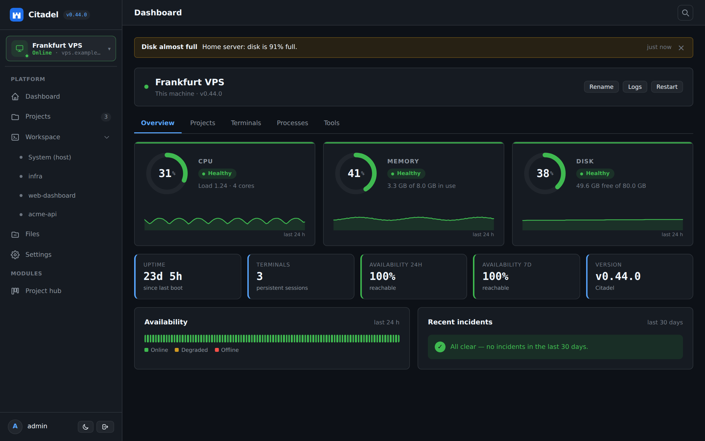

<div align="center">


# Citadel

**Your own command center for projects, terminals and AI coding agents.**<br>
Self-hosted, lightweight and secure. Runs on a VPS, a Mac or a spare laptop.

[](https://github.com/maksymhs/Citadel/releases)
[](LICENSE)


[Quick start](#-quick-start) ·
[Features](#-features) ·
[CLI](#-the-citadel-cli) ·
[Releases](#-releases) ·
[Docs](#-documentation) ·
[Changelog](CHANGELOG.md)

<br>

<picture>
  <source media="(prefers-color-scheme: light)" srcset="docs/img/dashboard-light.png">
  
</picture>

</div>

---

## ✨ Features

<table>
<tr>
<td width="50%" valign="top">

### 🖥️ Persistent terminals
`xterm.js` + `node-pty` + `tmux`. Close the browser, restart the panel: your sessions keep running. Phone-friendly, with on-screen keys, native text selection and clipboard copy.

</td>
<td width="50%" valign="top">

### 🤖 AI agent launcher
Run **Claude Code**, **Codex CLI**, **OpenCode**, **Antigravity**, **Kilo Code**, **Qwen Code** or your own binaries. Missing agents install with one click, once for every user.

</td>
</tr>
<tr>
<td valign="top">

### 📁 Projects & Git
Register, create, import and clone repositories with live branch status. Connect GitHub or GitLab and clone your private repos in one click.

</td>
<td valign="top">

### 🔐 Credential vault
One encrypted store (AES-256-GCM) for git tokens, env vars and SSH keys. Terminals get them at spawn; agents read them on demand with `citadel-creds`.

</td>
</tr>
<tr>
<td valign="top">

### 🌐 Paired machines
Pair Citadels with a QR code and switch between them from one URL. Survives rotating Cloudflare Quick Tunnel addresses, mesh-pairs automatically and propagates updates.

</td>
<td valign="top">

### 📊 Health & alerts
Online/offline, CPU, memory, disk, latency and 24 h / 7 d availability for every machine. Alerts to **webhook**, **ntfy** or **Telegram**, including security events.

</td>
</tr>
<tr>
<td valign="top">

### 🧩 Distributed task mesh
A pull-based work queue so one orchestrator agent can split work across nodes, with a dependency-free **MCP server**. See [task mesh](docs/task-mesh.md).

</td>
<td valign="top">

### 🗂️ Files & disk cleanup
Browse and edit the host filesystem, analyse disk usage and run quick cleanups with per-item selection.

</td>
</tr>
<tr>
<td valign="top">

### 🔭 Observability
Event trace plus periodic resource samples, a live sparkline, a filterable timeline and JSON/CSV export.

</td>
<td valign="top">

### 🪶 Lean by design
Fastify + SQLite (WAL). Runs on 512 MB of RAM. Plugin system with fault isolation. Optional Caddy and Docker integrations.

</td>
</tr>
</table>

<details>
<summary><b>More</b></summary>

- **Command palette** (`Ctrl/Cmd+K`) to jump to any screen, setting, machine or project.
- **Light, dark and system themes**, installable as a web app.
- **Domain publishing** through Caddy's local admin API with automatic HTTPS.
- **Idempotent installer** and systemd unit (Debian/Ubuntu), `launchd` on macOS.

</details>

## 🔒 Secure by default

| | |
| --- | --- |
| 🏠 Local-only | Listens on `127.0.0.1` unless you opt in to LAN or a tunnel |
| 🔑 Setup code | The first admin account needs a code only someone with shell access can read |
| 🍪 Strict sessions | `HttpOnly`, `SameSite=Strict` cookies, WebSocket origin validation, path-traversal prevention |
| 🧾 Audit log | Every sensitive action is recorded, credentials redacted |
| 🚫 Not root | The service runs unprivileged; every extra capability is an explicit flag |

Citadel does not sandbox projects from each other and a terminal is a shell with the service account's rights. Read the [limitations](docs/security.md) before exposing it.

## 🚀 Quick start

**Linux and macOS**, one line:

```bash
curl -fsSL https://raw.githubusercontent.com/maksymhs/Citadel/main/install.sh | bash
```

On Debian/Ubuntu add `sudo` before `bash` to install the system service. The installer prints the panel address, a **setup code** and a **QR**. Open the address and create the administrator account.

Every extra capability is opt-in:

| Flag | Effect |
| --- | --- |
| `--lan` / `--host=ADDR` | Reachable on your local network |
| `--no-tunnel` | Skip the public Cloudflare Quick Tunnel |
| `--admin-terminal[=user]` | Root-capable System Terminal (privileged) |
| `--no-updater` | Skip the in-panel updater |
| `--24-7` / `--no-24-7` | Keep a laptop awake with the lid closed, or not |
| `--check-only` | Preview what the installer would do |

**Windows** runs inside WSL2 (Ubuntu); **macOS** gets a menu bar icon. Updating, uninstalling, installing from a clone, laptop mode, tunnels and more are in [docs/installation.md](docs/installation.md).

### Requirements

| | |
| --- | --- |
| **OS** | Debian 11/12, Ubuntu 20.04–24.04, macOS 13+, Windows 10 (2004+) / 11 via WSL2 |
| **Arch** | `x86_64`, `arm64` |
| **Node.js** | 18 LTS or later |
| **Also** | Git, and tmux for session persistence (optional) |
| **RAM** | 512 MB minimum, 1 GB recommended for AI agents |

## 🧰 The `citadel` CLI

```bash
citadel status          # service, version, panel URL and health
citadel url             # print the panel URL
citadel qr              # one-time QR to pair another Citadel (10 minutes)
citadel setup-code      # first-run code to create the admin account
citadel update          # update to the latest version
citadel tunnel          # global URL via a Cloudflare Quick Tunnel
citadel logs            # follow the service logs
citadel restart         # also: start, stop
citadel doctor          # read-only host, network and Citadel diagnosis
citadel repair          # allow-listed recovery actions
citadel reset-password  # forgot the panel password (needs shell access)
```

Full reference, including Wi-Fi, power and menu bar commands: [installation](docs/installation.md#managing-citadel-citadel-cli) and [diagnostics & maintenance](docs/operations.md).

## 📦 Releases

Citadel follows `vX.Y.Z` tags. The panel checks GitHub for new releases and, with the updater installed, updates itself in one click and propagates the update to your paired machines. Pick the **stable** channel (latest release tag) or **main** (latest commit) in **Settings → Updates**.

| Latest | |
| --- | --- |
| **[v0.42.1](https://github.com/maksymhs/Citadel/releases/tag/v0.42.1)** | Maintenance: the web app code split into per-screen scripts with a browser-level smoke test, tests that no longer depend on the host, architecture and feature guides rewritten |
| [v0.42.0](https://github.com/maksymhs/Citadel/releases/tag/v0.42.0) | Redesigned machine overview and selector, real RAM and temperature on macOS, one-time Full Disk Access setup (`citadel permissions`), new README and guides, `AGENTS.md` for contributors and AI agents |
| [v0.41.0](https://github.com/maksymhs/Citadel/releases/tag/v0.41.0) | Setup code, security alerts, Tailscale wizard, WSL support, macOS menu bar icon, disk usage analysis and quick cleanup, `citadel reset-password`, Kilo Code and Qwen Code agents |
| [v0.40.0](https://github.com/maksymhs/Citadel/releases/tag/v0.40.0) | Light/dark theme, command palette, mobile terminal keys, redesigned dashboard and Settings, tools detection, custom machine names |

➡️ **[Full changelog](CHANGELOG.md)** · [All releases on GitHub](https://github.com/maksymhs/Citadel/releases)

## 📚 Documentation

| Guide | What's in it |
| --- | --- |
| [Installation & configuration](docs/installation.md) | Install, update, uninstall, WSL2, LAN, tunnels, pairing, updater, laptop mode |
| [Diagnostics & maintenance](docs/operations.md) | `doctor`, `network`, `wifi`, `repair`, rollbacks, uninstall options |
| [Security & limitations](docs/security.md) | Security layers and what Citadel does **not** protect against |
| [Remote access](docs/remote-access.md) | QR pairing, Cloudflare tunnels, own domain |
| [Task mesh](docs/task-mesh.md) | Parallel work across paired nodes |
| [Feature map](docs/features.md) | Which files make up each feature, with their tests and guide |
| [Code map](docs/code-map.md) | Every source file with its purpose, and where each screen lives |
| [Architecture](docs/architecture.md) · [Decisions](docs/decisions.md) | How it is built and why |

## 🛠️ Development

```bash
npm install     # dependencies and local xterm bundles
npm run doctor  # system health check
npm test        # full automated test suite
npm run dev     # development server (or: npm start)
```

Then open <http://127.0.0.1:3000>.

Contributing, with a human or an AI agent? [AGENTS.md](AGENTS.md) explains how the project is organised, how to make common changes, which docs to update and how releases work.

<details>
<summary><b>Repository layout</b></summary>

```
citadel/
├── server/      # Node.js + Fastify backend (config, database, security, services, routes)
├── public/      # SPA frontend: HTML5, responsive CSS, modular JS, local vendor bundles (0 CDNs)
├── plugins/     # Official plugins (plugin.json)
├── scripts/     # Installer helpers, updater, tunnel, doctor, uninstaller, systemd unit
├── tests/       # Automated tests
├── docs/        # Guides, architecture and ADRs
├── install.sh   # Main installer
└── CHANGELOG.md
```

</details>

## 📄 License

MIT. See [LICENSE](LICENSE).
