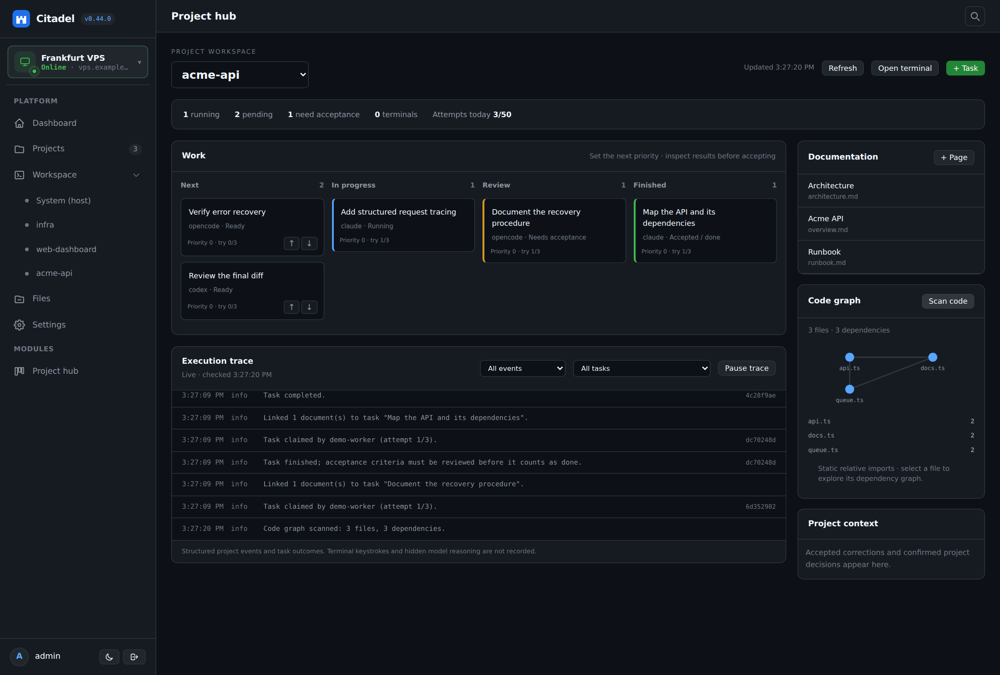

# Project hub: tasks, documentation, code and execution traces

Open **Project hub** in the sidebar and choose a registered project. This is one
optional module with one management view: priorities, pending/running/completed
tasks, project Markdown, confirmed decisions, a code graph and execution traces.
Enable or disable it in **Settings → Modules**. Its existing internal module ID
remains `missions`, preserving installation preferences and data. Old persisted
Work, Docs and Learning view IDs redirect to Project hub.

- **+ Task** queues work with instructions, an installed CLI agent and acceptance
  criteria. **Open terminal** opens the project's persistent workspace for any
  tool. A connected sentinel executes queued work; the hub explains when no
  worker is connected or the daily budget has stopped autonomous claims.
- **Work** has Next, In progress, Review and Finished columns. Raise/lower pending
  priorities; inspect a card for evidence, accept/reject, retry, cancel or record
  a correction. Running tasks are not silently interrupted by reprioritisation.
- **Documentation** lists Markdown inside the checkout. Read, create and edit
  pages with optimistic concurrency checks. Agents' Markdown appears here when
  the list refreshes; confirmed corrections appear as project context.
- **Code graph → Scan code** builds a bounded static file graph on demand. The
  overview and file inspector show relative imports and reverse dependencies.
- **Execution trace** shows real journal events, with task and warning/error
  filters, expandable scrubbed details and pause/resume. Pausing the trace does
  not pause work. Workspace and trace reads refresh every four seconds while
  this view is visible; leaving it stops polling. Failed refreshes show stale or
  disconnected status instead of claiming to be live.



The screenshot uses an isolated demo with simulated work, not production data.

## Trace and graph limits

Traces are scoped by a persisted `events.project_id` and indexed by project and
monotonic event ID. The first read returns up to 100 recent events; subsequent
reads use a cursor so a burst is paged without losing intermediate events. The
browser retains at most 300 events. Historical rows are backfilled where project
identity can be recovered from existing task/mission references; unresolvable
rows remain in Activity. Terminal lifecycle events record open, process exit or
persistent-session detachment. Keystrokes, raw terminal transcripts and private
model reasoning are not collected. Nested credential fields and matching secret
formats are scrubbed before recording and again when historical traces are read.

The code graph currently supports JS/TS relative imports, including CommonJS and
local index files. It is a static approximation, not a call graph: aliases,
external packages, dynamic expressions and other languages are not resolved.
Scanning does not execute project code or follow symlinks. It skips hidden and
vendor/build directories; limits are 250 files, 3,000 directory entries, 128 KiB
per source file, depth eight, 1,000 edges and a roughly three-second traversal.
The result states when limits apply and counts oversized files skipped. Results
are cached for 30 seconds in a bounded in-memory cache; Scan code refreshes it.
No watcher, background graph process, dependency or extra database is added.

## Existing mission API

A mission gives one goal to CLI agents over the [task mesh](task-mesh.md).
Claims, leases, retries, cancellation and reconciliation still use `tasks`.
The mission API retains roles, dependency plans, workspace files and versioned
plans. Project hub creates a single-task plan for simple directed work; advanced
multi-task plans and projectless legacy missions remain available through the
existing API. Documentation and memory endpoints remain compatible.

## What a mission contains

- **Goal** — free text, plus a title derived from its first line.
- **Plan** — 1-20 subtasks. Each has a role (`planner`, `analyst`, `developer`, `backend`,
  `frontend`, `qa`, `reviewer`, `docs`, `devops`), an optional description,
  optional `agent` (`claude`, `opencode` or `codex`), an optional `exclusive`
  flag and `deps`, earlier task indices.
- **Dependencies** — a task starts `blocked` and is released to `queued` only
  when every dependency is `done`.
- **Workspace** — `$CITADEL_MISSIONS_DIR/<mission-id>/` (default
  `data/missions/`), never the project checkout:

  ```
  goal.md          plan.json        decisions.md
  handoff/<NN>-<role>-<title>.md    artifacts/
  ```

  Each prompt points at the goal and at its dependencies' handoff files; the
  agent writes its own handoff. Context therefore passes through files instead
  of ever-growing prompts, and survives retries and agent changes.

## Two ways to plan

1. **Let an agent plan.** The mission enqueues a `planner` task. The planner
   writes `plan.json` (or prints a fenced JSON block) and the server validates it
   before enqueuing a single subtask. A rejected plan leaves the mission in
   **Review** with the reason; import a replacement through the plan endpoint.
2. **Supply a plan.** Send `plan` to `POST /api/missions`, or import one through
   `POST /api/missions/:id/plan`. The same validation runs server-side.

```json
{"tasks": [
  {"title": "Inspect the code", "role": "analyst"},
  {"title": "Implement the change", "role": "backend", "deps": [0], "exclusive": true},
  {"title": "Run the tests", "role": "qa", "deps": [1]}
]}
```

Validation rejects unknown roles/agents, duplicate titles, forward or cyclic
dependencies, more than 20 tasks, and any attempt by the plan to choose a
command, a project path or a file path.

## Running the team

Missions do not execute anything themselves. A **sentinel** must be running and
reporting on this host (or on a paired node):

```bash
CITADEL_URL=http://127.0.0.1:3000 \
CITADEL_NODE_TOKEN=<node token> CITADEL_NODE=local \
CITADEL_CAPACITY=2 node scripts/sentinel.js
```

The board warns when no node has sent a heartbeat in the last two minutes.
Keep `CITADEL_CAPACITY` low on small machines: each slot is a full agent process.
An `exclusive` task is only claimed when no other exclusive task is running in
the same project, which keeps two writers out of one checkout.

## Board, priority and cancellation

- Columns: Next (queued/blocked/quota), In progress (running/cancelling), Review
  (awaiting acceptance/failed), Finished (done/cancelled).
- **↑ / ↓** changes a queued or blocked task's priority through
  `POST /api/missions/:id/prioritize`. Running tasks cannot be reprioritised.
- **Cancel task** requests cancellation through the task protocol. The mission
  cancellation endpoint still cascades to its unfinished tasks.
- Workspace files (handoffs, goal, plan and decisions) remain accessible through
  the mission file API. The hub's Documentation panel reads project Markdown.

## Acceptance review

A successful autonomous task whose plan declared `acceptance` criteria does not
count as `done`. It ends in **Needs review**: the process is over, nothing is
claimed again, and dependent tasks stay `blocked`. The board card and the task
detail expose **Accept result** and **Reject result**:

- **Accept** (`POST /api/missions/:id/tasks/:taskId/review {accepted:true}`)
  moves the task to `done`, records `reviewed_at`/`reviewed_by` and releases
  dependants.
- **Reject** moves it to `failed` with the note as evidence and
  `blocked_reason = 'rejected'`, so it is not counted as done and feeds the
  learning memory. A rejected review re-runs the task's failure classification.
- **Retry task** (`POST /api/tasks/:id/retry`) requeues a failed task while
  attempts remain, clearing stale result/error/lease state but keeping the
  review note and recorded lesson. When attempts are exhausted, revise the plan
  or enqueue a new task instead.

Tasks without acceptance criteria keep the normal completion path. This is the
minimum honest gate: Citadel does not invent a test command, and the operator
owns the decision.

## Budget

Autonomous work is bounded by `CITADEL_AUTONOMOUS_DAILY_BUDGET` (default 50,
`0` pauses autonomy). The counter is the number of autonomous attempts started
today, local time; it is a budget proxy because no paid provider is integrated.
When it is exhausted, new autonomous attempts are not claimed, the project summary
shows the counter, and manual queue work and persistent terminals keep running.
It resets at local midnight.

## HTTP API

```
GET  /api/missions                 list (optional ?status=&limit=)
POST /api/missions                 {goal, projectId?, title?, plan?, plannerAgent?}
GET  /api/missions/meta            roles + headless agents, install state and today's budget
GET  /api/missions/:id             mission + tasks + files
POST /api/missions/:id/plan        import a validated plan
POST /api/missions/:id/prioritize  {order:[taskId]} or {taskId, priority}
POST /api/missions/:id/cancel      cascade cancel
POST /api/missions/:id/notes       {text} appends to decisions.md
GET  /api/missions/:id/files
GET  /api/missions/:id/file?path=  goal.md, plan.json, decisions.md or handoff/*
```

## Security and limits

- Administrator-only; the module can be disabled in Settings → Modules.
- Plans are untrusted model output: they are validated and can only reference
  roles, earlier tasks and installed headless agents. They can never inject a
  `cmd` or a path.
- Workspace reads are confined with a resolved-path guard; handoffs are files
  under the mission directory only.
- Prompts and results are bounded by the task service (20 000 result
  characters), which is why handoffs are files rather than prompt payloads.
- Agents run with the service account's permissions against the project. This
  MVP does not create git worktrees: use `exclusive` for writers, or let only
  one writer task depend on the analysis stage. Worktree isolation and a merge
  gate are the next step.
- Missing headless mapping: only `claude`, `opencode` and `codex` can be
  enqueued as agents. Qwen, Kilo and Antigravity are installable but not yet
  headless targets.


## Autonomous loop and states

The loop is: pick a ready mission → retrieve its docs and applicable lessons →
plan (or reuse a valid plan) → claim one eligible task → run one agent → collect
the result → validate/review → record evidence and learning → release dependants
→ continue. It stops when every required task is done, when a human review is
needed, or when the mission is blocked by policy/quota.

Task states map to the existing task-mesh rows:

| UI state | Row | Meaning |
| --- | --- | --- |
| Ready | `queued` | Dependencies satisfied, claimable. |
| Running | `running` | A sentinel holds a claim and a lease. |
| Blocked | `blocked` | A dependency, policy or human intervention is missing. |
| Waiting quota | `quota` | The provider reported quota/rate limiting; paused until the next cautious check. |
| Needs review | task `review` (mission `review`) | A finished task with acceptance criteria awaits an accept/reject decision; the mission is in review until it is decided. |
| Done | `done` | Task exited successfully; mission is done only when every required task is done. |
| Failed | `failed` | Attempts/lifetime exhausted; evidence and a lesson are retained. |
| Cancelled | `cancelled` / `cancelling` | Cancellation requested or confirmed by the worker. |

A task carries `acceptance` criteria and optional `refs` (files, docs, commits).
In the task detail an operator can **Accept result** or **Reject result**. A
rejected result becomes `failed` with the note as evidence, so it is not counted
as done and becomes learning input. This is the minimum validation Citadel can
apply without inventing a test command or a second model.

### Concurrency and recovery

- Mission tasks are marked `autonomous=1`. `claimTask` refuses to start a second
  autonomous attempt anywhere in the instance while one is running. Manual queue
  work and persistent terminals are unaffected.
- `exclusive` additionally keeps two writers out of the same project checkout.
- Dependencies are released only when every dependency is `done`.
- Claims, leases, claim tokens, execution identity, reconciliation and
  cancellation confirmation are unchanged from the [task mesh](task-mesh.md).
  An expired lease never starts a duplicate autonomous attempt by itself.
- A mission and its plan are persisted before the first task is enqueued.
  Restart recovery is the normal task-mesh recovery plus an idempotent mission
  refresh on every read.

### Quota and failure handling

The task result text is classified. Quota/rate-limit failures become `quota`,
clear the sticky failure state, and record a `retry_at` cooldown
(`CITADEL_QUOTA_COOLDOWN_MS`, default 15 minutes, bounded to 1 minute–24 hours).
That timestamp is a **next check**, never a claimed provider reset time. Work
resumes only after the cooldown, while attempts remain, and no continuous retry
loop runs. Every other failure gets a deterministic, visible class — `auth`,
`network`, `tests`, `interrupted`, `agent` or `unknown` — stored on the task as
`failure_kind`. The class is advisory evidence, not a confirmed root cause, and
it never changes a security policy. An unknown process state remains governed by
the sentinel journal and reconciliation, not by a blind retry.

### Planning and revisions

The planner gets the goal, a bounded list of related project docs and the
applicable lessons. It writes `plan.json` (or fenced JSON); the server validates
roles, dependencies, size, agents and acceptance criteria before enqueuing
anything. `POST /api/missions/:id/plan/revision` replaces only pending work,
keeps completed evidence, detaches superseded pending tasks and stores every
plan version in `mission_plan_versions`.

## Docs: Markdown in the project checkout

Docs are stored under the project plus `CITADEL_DOCS_SUBDIR` (default `docs`).
The body is never copied into SQLite; `documents` stores title, path, task and
mission links and timestamps. Opening the view lists files but does not create
the directory. Creating a page uses `flag: 'wx'`, so an existing file is never
overwritten. Edits are written to the checkout and therefore show up in Git;
the view shows uncommitted docs files. Paths, extensions (`.md`/`.markdown`) and
symlinks are checked against the canonical project and docs roots. Content that
looks like a credential is refused instead of written.

Relations are stored in SQLite: `document_links` records every
`[[other-page]]` / `[[other-page.md]]` wiki link, and `document_refs` records the
tasks and missions a page belongs to. Reading a page returns its outbound
`links`, its `backlinks` and its `refs`; links are re-synced from the body on
read, so editing Markdown by hand is enough. A task's result and handoff are
scanned for Markdown paths and wiki links once per attempt, and matching pages
are attributed to that task and mission (`docs_linked` makes it idempotent). Only pages
relevant to a change should be updated; the planner is instructed to add a docs
task when architecture, public behaviour, configuration, installation, security
or operations change.

API: `GET /api/docs`, `GET /api/docs/file`, `POST /api/docs`, `PUT /api/docs`,
`POST /api/docs/link` (all take `projectId`; admin only).

The legacy `task_id`/`mission_id` columns stay as the most recent single link;
the relation tables are authoritative.

## Learning: project and global memory

Every lesson is a compact structured row: problem, context, root cause (with
`root_cause_confirmed`), solution, preventive rule, components, evidence, source,
scope, status, occurrence count, task/mission origin and timestamps. Secrets and
long credentials are redacted before storage. Logs and full conversations are
not stored.

- **Sources:** failures, repeated failures, successful resolutions after a
  retry, user corrections and manual operator notes.
- **Deduplication:** a deterministic `dedupe_key` updates the existing row and
  increments `occurrences` instead of creating near-duplicates.
- **Scopes:** failures and corrections are always `project`. `global` exists only
  after an explicit **Promote to global** action by an administrator. There is no
  automatic promotion, even when a pattern repeats across projects.
- **Retrieval:** deterministic SQL by project/status and keyword matching, project
  lessons first, then promoted global knowledge. The mission records the lesson
  ids it used (`used_lessons`) so Work can show which memory influenced a plan.
- **Lifecycle:** `pending`, `confirmed`, `discarded`, `superseded`; a superseded
  lesson keeps its history but is no longer retrieved.
- **Authority:** memory is advisory. Current user instructions, security policy
  and the actual code always win; an agent hypothesis is never presented as a
  proven root cause.

A correction can be recorded from the task detail. It becomes confirmed project
memory immediately, is attached to the task and appended to the mission notes.
It is not treated as a global user preference.

API: `GET /api/learning`, `GET /api/learning/relevant`,
`POST /api/learning`, `POST /api/learning/:id/{confirm,discard,supersede,promote}`
(admin only).

## Security boundaries

- The whole module is administrator-only and can be disabled in Settings → Modules.
- Plans and agent output are untrusted: no command, binary path or project path
  can come from a plan. Agents execute through the existing registry mapping.
- Mission workspaces are under `CITADEL_MISSIONS_DIR` (default `data/missions/`),
  not the checkout. Docs are confined to the project's docs root with real-path
  checks.
- An agent cannot change security policy or write global lessons. Global
  promotion and task review are operator actions and are audited.
- No paid inference is enabled implicitly: autonomous work uses the same local
  CLI agents and their existing quotas/authentication.

The daily budget persists separately from task rows and increments inside the
claim transaction for **every attempt**, including retries of older tasks.
Deleting task history does not refund usage. On upgrade from the earlier
counter, all attempts of tasks first started today are counted conservatively;
older versions did not retain exact attempt dates. New claims are counted
exactly thereafter. Plan publication and revision commit the plan version and
all task changes in one SQLite transaction; `plan.json` is an auxiliary copy.
Docs references accumulate across page updates, including pages written directly
by agents. Handoff discovery checks canonical paths and file size.
